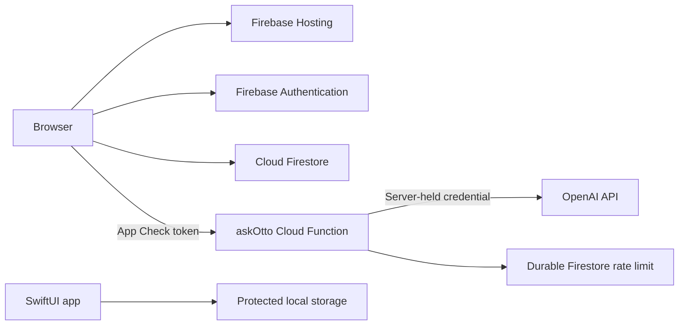

<p align="center">
  
  &nbsp;&nbsp;&nbsp;
  
</p>

# AutonoHealth

<p align="center"><strong>Evidence-based health education, practical self-tracking, and safer AI guidance in one calm experience.</strong></p>

AutonoHealth is an independent product design and engineering project exploring how trustworthy health education can feel clear, useful, and approachable without pretending to replace professional care. The project combines a production-minded responsive website, a secure Firebase/OpenAI backend, and an early native SwiftUI migration.

> AutonoHealth provides general educational information. It does not diagnose, prescribe, or replace care from a qualified healthcare professional.

## Product overview

The web experience connects four ideas that are often fragmented across different products:

- **Understand:** 32 plain-language condition overviews covering symptoms, urgent warning signs, useful tracking, and common care approaches.
- **Compare:** 81 treatment cards with indication-specific evidence notes rather than one oversimplified rating per treatment.
- **Track:** A customizable daily tracker that works locally when signed out and syncs to a private Firestore path after Google sign-in.
- **Ask:** Otto, a conversational guide that explains the site, respects clear medical boundaries, and only receives a 14-day tracker summary after explicit opt-in.

The site also includes global search, an Evidence Center, a Learning Hub, a shop concept, visit-planning tools, and calculators for BMI, sleep debt, caffeine clearance, fasting duration, Pomodoro intervals, and Cockcroft–Gault creatinine clearance.

## Highlights

- Responsive multi-page design system built with semantic HTML, modern CSS, and vanilla JavaScript
- Searchable and filterable condition and treatment libraries
- Four-level evidence framework: **Strong**, **Moderate**, **Limited or mixed**, and **Insufficient**
- Local-first tracker with custom fields, history, export, deletion, and optional authenticated sync
- Server-owned AI prompt and fixed model configuration
- Explicit preview and consent before tracker summaries are sent for AI processing
- Local emergency-language detection that runs before any network request
- Keyboard navigation, visible focus states, accessible labels, live regions, and reduced-motion support
- Native SwiftUI foundation with protected local persistence and unit-tested tracker/content layers

## Architecture



| Layer | Technology | Responsibility |
|---|---|---|
| Web client | HTML, CSS, vanilla JavaScript | Content, tools, tracker UI, consent, accessibility |
| Hosting | Firebase Hosting | Static delivery, routing, caching, security headers |
| Identity and data | Firebase Authentication and Firestore | Google sign-in and per-user tracker synchronization |
| Abuse protection | Firebase App Check and Firestore | App attestation and durable request limiting |
| AI proxy | Node.js 22 Cloud Function | Validation, server-owned prompt, spending boundaries, OpenAI request |
| Native client | SwiftUI | iOS design system, exploration, tools, and protected local tracking |

## Security and privacy design

The repository is structured so it can be public without publishing spending credentials:

- OpenAI credentials are loaded from Google Secret Manager and never shipped to the browser or iOS bundle.
- Firebase browser configuration and the reCAPTCHA site key are treated as public identifiers; authorization comes from Authentication, Firestore rules, and App Check.
- Otto accepts only bounded conversation turns and optional bounded tracker context. Browser-supplied system instructions are ignored.
- The model, reasoning effort, output ceiling, trusted prompt, and storage setting are controlled on the server.
- Rate limits persist across function instances and store only a server-keyed HMAC of the requester address with an expiry timestamp.
- Firestore rules restrict tracker documents to their authenticated owner and validate expected paths, fields, and collection sizes.
- Hosting sends a Content Security Policy, HSTS, anti-framing, permissions, referrer, and MIME-sniffing protections.
- Signed-out tracker data remains in the browser. Signed-in data syncs to the user's private Firestore path.
- Tracker summaries are excluded from Otto requests until the person explicitly opts in and can preview the exact summary.

See [SECURITY.md](SECURITY.md) for credential and vulnerability-reporting guidance and [LAUNCH.md](LAUNCH.md) for the secure deployment checklist.

## Repository structure

```text
.
├── autonohealth-website/       Responsive website and Cloud Function
│   ├── assets/                 Shared styles, browser logic, Firebase client
│   └── functions/              Otto proxy, server prompt, tests, dependencies
├── AutonoHealth-iOS/           Native SwiftUI migration
├── firebase.json               Hosting, routing, headers, and function config
├── firestore.rules             Per-user data access and schema boundaries
├── LAUNCH.md                   Secure deployment checklist
└── SECURITY.md                 Credential and vulnerability policy
```

## Run locally

### Website preview

Serve `autonohealth-website` from a local web server. For example:

```sh
python3 -m http.server 8000 --directory autonohealth-website
```

Then open `http://localhost:8000`. Static pages, tools, and local tracker behavior work in this preview. Authentication, Firestore sync, App Check, and Otto require the configured Firebase environment described in [LAUNCH.md](LAUNCH.md).

### Backend tests

```sh
cd autonohealth-website/functions
npm install
npm test
```

The tests verify the server-owned prompt boundary, tracker-context labeling, conversation validation, response translation, and rate-limit identifiers.

### iOS app

1. Open `AutonoHealth-iOS/AutonoHealth.xcodeproj` in Xcode 16 or newer.
2. Choose an Apple Developer team under Signing & Capabilities.
3. Run the `AutonoHealth` target on an iPhone simulator.

See [AutonoHealth-iOS/README.md](AutonoHealth-iOS/README.md) for the native migration plan.

## Selected engineering decisions

### Evidence ratings belong to claims, not products

A treatment can have strong evidence for one indication and limited evidence for another. The content model therefore attaches evidence notes to a specific treatment, use, and outcome rather than presenting a misleading universal score.

### Local-first tracking with a deliberate sync boundary

The tracker remains useful without an account. Signing in changes the storage adapter to Firestore and migrates local entries, while the same normalized model powers local storage, sync, export, history, and Otto context.

### AI is an interface, not the source of truth

Otto's role, site knowledge, and safety boundaries live on the server. Immediate crisis language is handled locally, model access is bounded, and the browser cannot select a more expensive model or replace the trusted prompt.

### The iOS migration starts with a vertical slice

The native app first validates navigation, visual tokens, protected persistence, content modeling, and testing. Later phases will move editorial content into a shared structured source before adding account sync and native Otto access.

## Current status and roadmap

The web application is feature-complete as a portfolio beta and has received a security-focused implementation pass. The SwiftUI app is an early native vertical slice.

Before describing AutonoHealth as a production healthcare service, the project still requires:

- Documented review of medical and evidence content by qualified reviewers
- Formal privacy, legal, threat-modeling, and data-governance review
- Production App Check enforcement, budget controls, monitoring, and incident procedures
- Expanded integration, Firestore rules, accessibility, and cross-browser testing
- A shared structured content source for the web and native clients
- App Store privacy disclosures, release assets, and production signing for iOS

This project is not represented as HIPAA-compliant, a medical device, or a substitute for individualized clinical care.
